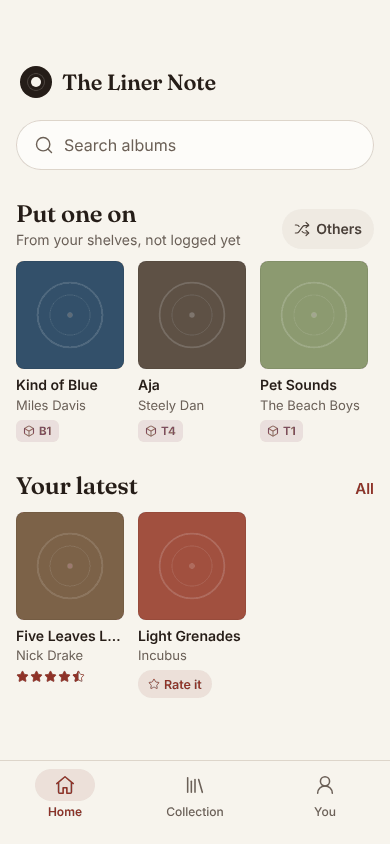
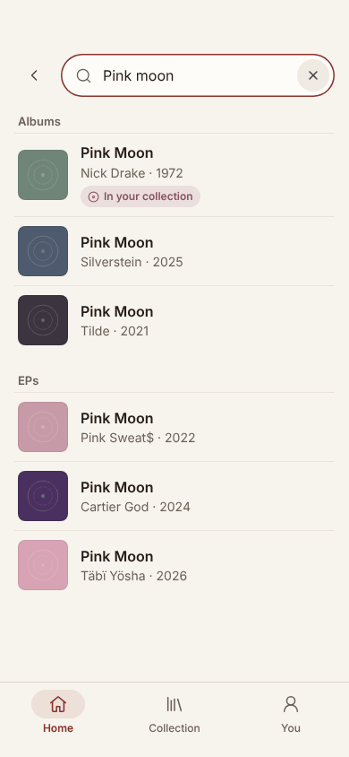
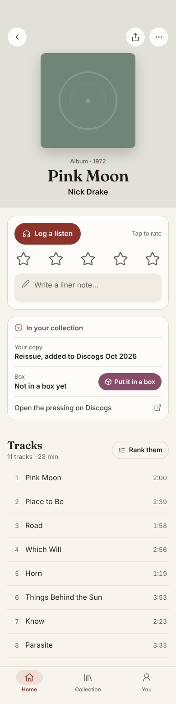
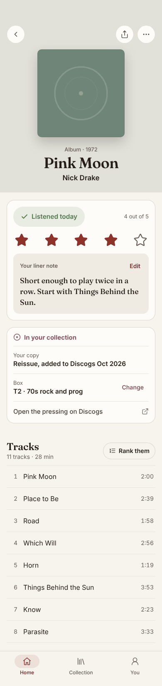
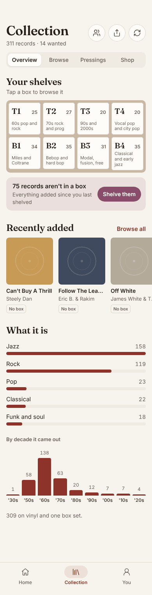
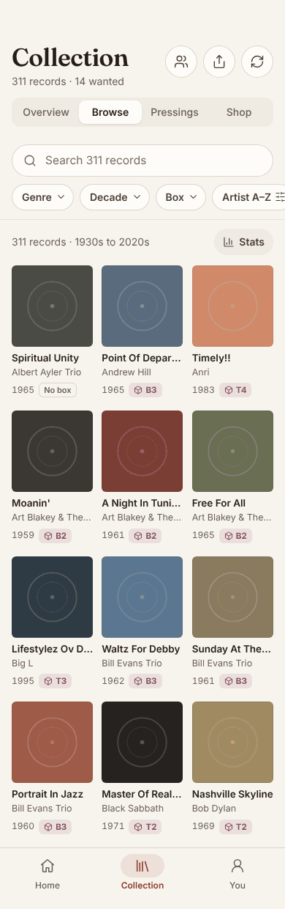
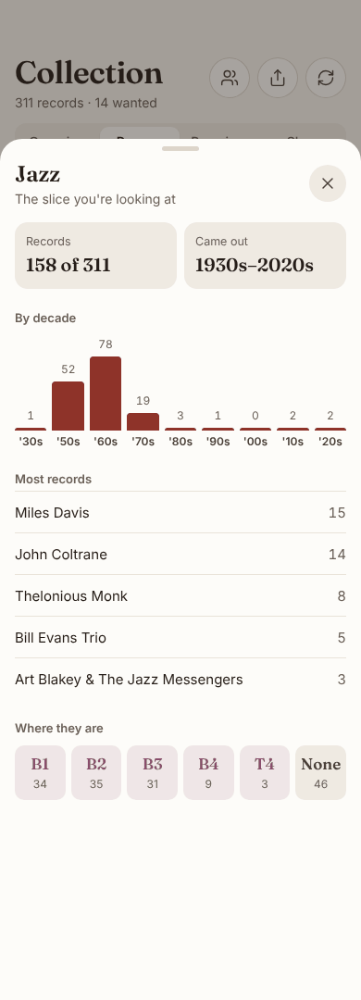
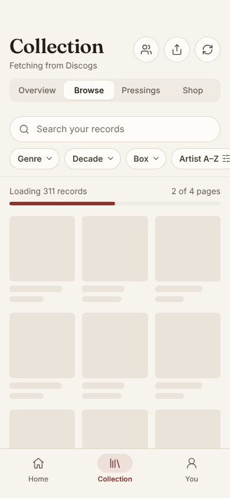

# Design: The Liner Note, modernized

Start with [HANDOFF.md](HANDOFF.md). Album covers in these renders are placeholders.

| Home | Search | Album | Album, logged |
|---|---|---|---|
|  |  |  |  |

| Collection | Browse | Stats | First load |
|---|---|---|---|
|  |  |  |  |

- `screens/png/`: every board as an image; `screens/*.html`: the same boards as pages.
- `mockup-src/`: the canvas boards, and `render.mjs`, which regenerates `screens/*.html`.
- `09-box-sheet` and every box element are a later step (see the handoff).
